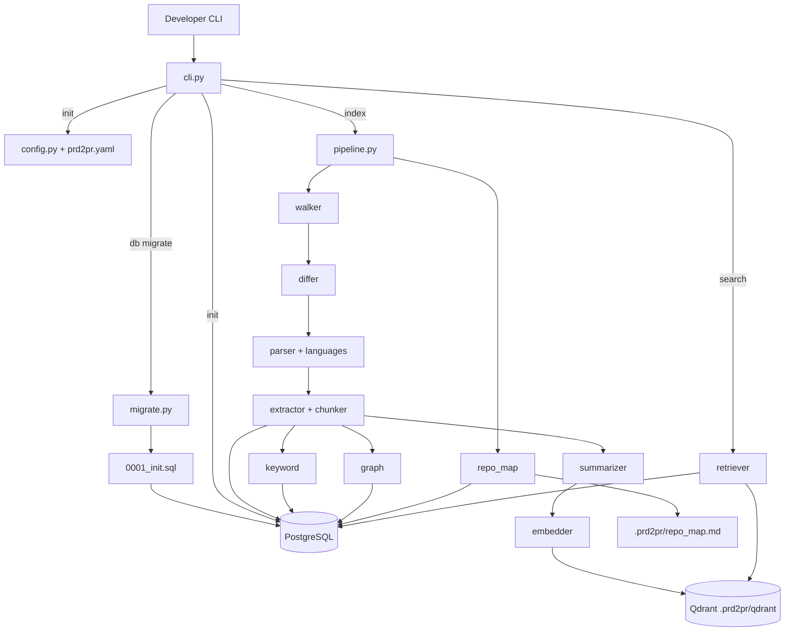
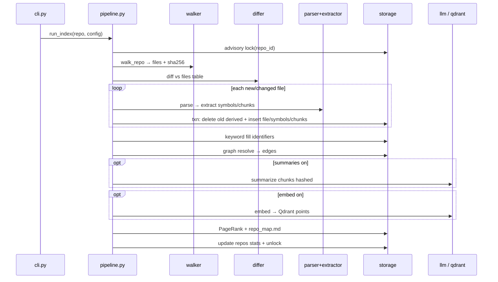

# prd2pr Phase 1 — Working Tree & Workflow

Phase 1 = **Indexing Engine**. Input: local TypeScript/JavaScript or Python repo.  
Output: searchable indexes in **PostgreSQL** + **Qdrant (local)**.  
Out of scope: PRD parsing, planning, code generation, GitHub.

---

## 1. File tree (who is parent of whom)

```
Galactus/
├── pyproject.toml              # package root — deps, entry point prd2pr
├── docker-compose.yml          # local Postgres:16
├── README.md
├── .env                        # secrets only (PRD2PR_DATABASE_URL, API keys)
│
├── src/prd2pr/                 # ★ PACKAGE ROOT
│   ├── __init__.py
│   ├── cli.py                  # ★ USER ENTRY — Typer commands
│   ├── config.py               # prd2pr.yaml load/validate (Pydantic)
│   │
│   ├── indexing/               # ★ PIPELINE HEART
│   │   ├── pipeline.py         # ★ ORCHESTRATOR — steps 1→7
│   │   ├── walker.py           # step 1: walk + filter + hash
│   │   ├── differ.py           # step 2: new/changed/deleted
│   │   ├── parser.py           # step 3: tree-sitter parse
│   │   ├── extractor.py        # step 4: symbols + chunks (+ raw refs)
│   │   ├── chunker.py          # chunk text + headers + identifier split
│   │   ├── ids.py              # stable ID helpers
│   │   ├── keyword.py          # step 5b: identifiers → FTS
│   │   ├── graph.py            # step 5c: resolve imports/calls → edges
│   │   ├── summarizer.py       # step 5a prep: LLM summaries
│   │   ├── embedder.py         # step 5a: vectors → Qdrant
│   │   ├── repo_map.py         # step 6: PageRank → repo_map.md
│   │   └── languages/          # language plugins (only extractor uses these)
│   │       ├── __init__.py     # get_adapter(language)
│   │       ├── base.py         # LanguageAdapter + RawSymbol/Import/Call
│   │       ├── typescript.py   # TS/JS queries
│   │       └── python.py       # Python queries
│   │
│   ├── storage/                # ★ ONLY layer that talks to DB / Qdrant
│   │   ├── db.py               # psycopg pool from PRD2PR_DATABASE_URL
│   │   ├── migrate.py          # apply numbered .sql files
│   │   ├── pg_store.py         # all Postgres CRUD
│   │   ├── vector_store.py     # Qdrant local wrapper
│   │   └── migrations/
│   │       └── 0001_init.sql   # schema: repos, files, symbols, chunks, edges
│   │
│   ├── llm/
│   │   └── client.py           # LiteLLM summaries + embeddings
│   │
│   └── search/
│       └── retriever.py        # keyword | semantic | graph | hybrid (RRF)
│
└── tests/
    ├── conftest.py
    ├── fixtures/ts_sample/     # Express + NestJS-style fixture
    └── fixtures/py_sample/     # FastAPI + Pydantic fixture
```

### Parent → child (import / call hierarchy)

| Parent | Children it owns / calls |
|--------|---------------------------|
| **`cli.py`** | `config`, `db`, `migrate`, `pg_store`, `pipeline`, `retriever`, `vector_store`, `llm` |
| **`pipeline.py`** | `walker` → `differ` → `parser` → `extractor` → (`keyword` \|\| `graph` \|\| `summarizer`+`embedder`) → `repo_map` → `pg_store` / `vector_store` |
| **`extractor.py`** | `parser` result + `languages.get_adapter` + `chunker` + `ids` |
| **`languages/*`** | only `base.py` types; never touch storage |
| **`summarizer` / `embedder`** | `llm.client` + `pg_store` / `vector_store` |
| **`search/retriever.py`** | `pg_store` + `vector_store` + optional `llm` |
| **`migrate.py`** | `db` + `migrations/*.sql` |
| **`pg_store.py`** | only `psycopg` connection (no business logic above) |

**Rule:** modules outside `storage/` never open Postgres or Qdrant themselves — they go through `PgStore` / `QdrantVectorStore`.

---

## 2. High-level data flow



---

## 3. CLI commands → files

| Command | What happens | Main files |
|---------|--------------|------------|
| `prd2pr db migrate` | Apply pending SQL; record in `schema_migrations` | `cli` → `migrate` → `db` → `0001_init.sql` |
| `prd2pr init` | Write `prd2pr.yaml`, insert `repos` row → `repo_id` | `cli` → `config` → `pg_store` |
| `prd2pr index` | Full/incremental pipeline | `cli` → `pipeline` → all indexing/* + storage/* |
| `prd2pr status` | Counts, last commit, stale files | `cli` → `walker` + `differ` + `pg_store` |
| `prd2pr search "q"` | Debug retrieval | `cli` → `retriever` → PG and/or Qdrant |

Typical first-time flow:

```bash
docker compose up -d
export PRD2PR_DATABASE_URL=...   # or source .env
prd2pr db migrate
prd2pr init --repo /path/to/code
prd2pr index --repo /path/to/code --no-embed --no-summaries   # offline OK
prd2pr search "cancel order" --mode keyword
```

---

## 4. Index pipeline — step by step

`pipeline.run_index()` runs these in order. Steps **5a / 5b / 5c** are independent of each other (same inputs from step 4).



| Step | Module | Input | Output |
|------|--------|-------|--------|
| **1 walk** | `walker.py` | repo path, `prd2pr.yaml` ignore | relative paths, language, `content_hash` |
| **2 diff** | `differ.py` | walked files vs `files` table | new / changed / deleted / unchanged |
| **3 parse** | `parser.py` | file bytes + language | in-memory tree-sitter AST (never stored) |
| **4 extract** | `extractor.py` + `languages/*` + `chunker.py` | AST | `symbols`, `chunks`, raw imports/calls/config |
| **5a embed** | `summarizer.py` → `embedder.py` → `vector_store.py` | chunks (+ summaries) | Qdrant named vectors `code` / `summary` |
| **5b keyword** | `keyword.py` + PG generated `search_tsv` | identifiers text | FTS via GIN |
| **5c graph** | `graph.py` | raw refs + symbol index | `edges` (imports, calls, routes, …) |
| **6 repo map** | `repo_map.py` | symbol graph | `.prd2pr/repo_map.md` + `symbols.rank` |
| **7 commit** | `pipeline` + `pg_store` | run stats | `repos.last_indexed_commit`, `last_run_stats` |

### Flags

- `--full` — treat every file as changed  
- `--no-summaries` — skip LLM summaries  
- `--no-embed` — skip Qdrant (works with no API key)

---

## 5. Stable IDs (shared across PG + Qdrant + graph)

| Thing | ID form | Example |
|-------|---------|---------|
| Repo | `repos.id` BIGSERIAL | `1` |
| File | relative path | `src/orders/order.service.ts` |
| Symbol | `file::Qualified.name` | `…/order.service.ts::OrderService.cancelOrder` |
| Chunk | `symbol_id#part` | `…::OrderService.cancelOrder#0` |
| File chunk | `file::__file__#0` | tiny symbols merged |
| Qdrant point | UUIDv5(`repo_id:chunk_id`) | deterministic |

Overloads: append `@<start_line>` to the symbol id.

---

## 6. Storage model (who writes what)

```
repos 1──* files 1──* symbols
              │
              └──* chunks  (search_tsv generated from identifiers + summary)
repos 1──* edges   (src → dst: imports | calls | extends | handles_route | defines | uses_config)
```

| Store | Path / connection | Written by |
|-------|-------------------|------------|
| PostgreSQL | `PRD2PR_DATABASE_URL` | `pg_store` via `db` pool |
| Qdrant local | `<repo>/.prd2pr/qdrant/` | `vector_store` |
| Repo map | `<repo>/.prd2pr/repo_map.md` | `repo_map` |
| Run logs | `<repo>/.prd2pr/logs/*.jsonl` | `pipeline` |
| Config | `<repo>/prd2pr.yaml` | `config` / `init` |

---

## 7. Language adapter plugin path

```
parser.parse_file(bytes, language)
        │
        ▼
extractor.extract_file(...)
        │
        ├── get_adapter("typescript"|"javascript") → TypeScriptAdapter
        └── get_adapter("python")                  → PythonAdapter
                │
                ▼
        RawSymbol / RawImport / RawCall / RawConfigRef / RawExtends
                │
                ▼
        chunker.chunk_symbols(...) → ChunkDraft → PG rows
```

Adding a language later = one new file under `languages/` + register in `get_adapter`. Pipeline stays untouched.

---

## 8. Search modes (`search/retriever.py`)

| Mode | Source | How |
|------|--------|-----|
| `keyword` | Postgres FTS | `websearch_to_tsquery` + `ts_rank_cd` |
| `semantic` | Qdrant | query both named vectors `code` + `summary`, merge |
| `graph` | Postgres edges | top keyword hit → neighbors up to 2 hops |
| `hybrid` | all | RRF: `Σ 1/(60+rank)` over keyword+semantic, then 1-hop expand top 5 |

Always filtered by `repo_id` (many repos, one database).

---

## 9. Incremental update (FR10)

On **changed** file (one PG transaction):

1. Delete old symbols / chunks / outgoing edges for that file  
2. Delete matching Qdrant points  
3. Insert fresh symbols + chunks  
4. Later: rebuild edges; mark dangling as `resolved=false` and re-resolve  

On **deleted** file: remove file row (CASCADE symbols/chunks) + edges by `src_file` + Qdrant points.

Unchanged files → **0** parse, **0** LLM calls.

Two `index` runs on same repo: `pg_try_advisory_lock(repo_id)` — second fails fast.

---

## 10. “Where do I look?” cheat sheet

| I want to… | Open this file |
|------------|----------------|
| Add a CLI flag | `cli.py` |
| Change ignore / limits / models | `config.py` + `prd2pr.yaml` |
| Change pipeline order | `indexing/pipeline.py` |
| Fix symbol extraction for TS | `indexing/languages/typescript.py` |
| Fix symbol extraction for Python | `indexing/languages/python.py` |
| Change chunk size / headers | `indexing/chunker.py` |
| Fix import/call resolution | `indexing/graph.py` |
| Change SQL schema | `storage/migrations/0001_init.sql` (+ new migration) |
| Change any DB query | `storage/pg_store.py` |
| Change vectors / Qdrant | `storage/vector_store.py` + `indexing/embedder.py` |
| Change search ranking | `search/retriever.py` |
| Mock LLM in tests | `tests/conftest.py` (`fake_llm`) |

---

## 11. Mental model (one sentence each)

1. **`cli.py`** is the front door.  
2. **`pipeline.py`** is the conductor.  
3. **`languages/*`** understand source code.  
4. **`storage/*`** own persistence.  
5. **`search/retriever.py`** proves the index is useful before planning exists.

That’s the whole of Phase 1.
